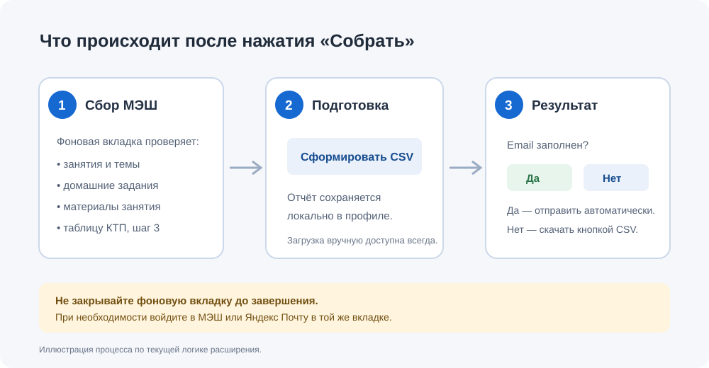

# МЭШ — недельная выгрузка преподавателя

Расширение для Microsoft Edge и Google Chrome. Оно собирает расписание преподавателя, проверяет карточки занятий и читает таблицу КТП, а затем сохраняет отчёт в CSV. По желанию CSV можно автоматически отправить через Яндекс Почту.

> Скриншоты интерфейса сделаны в Microsoft Edge. Расположение элементов и внешний вид могут отличаться в другой версии браузера.

## Установка в Edge или Chrome

1. Скопируйте папку `mesh_weekly_exporter` в постоянное место на компьютере. Не удаляйте и не перемещайте её после установки: браузер загружает расширение из этой папки.
2. Откройте страницу расширений в нужном браузере:
   - Microsoft Edge: введите `edge://extensions` в адресную строку.
   - Google Chrome: введите `chrome://extensions`.
3. Включите переключатель **Режим разработчика**.
4. Нажмите **Загрузить распакованное** и выберите папку `mesh_weekly_exporter` целиком — ту, в которой лежит `manifest.json`.
5. Убедитесь, что расширение появилось в списке и включено.
6. Чтобы открывать его быстрее, закрепите его на панели браузера: откройте меню расширений (значок пазла) и нажмите значок закрепления рядом с «МЭШ — недельная выгрузка преподавателя».
7. В этом же профиле браузера откройте сайт МЭШ и войдите в кабинет преподавателя.

На скриншотах показаны включённый режим разработчика и установленное расширение:

**После обновления файлов расширения:** откройте страницу расширений, нажмите **Обновить** на карточке расширения, затем перезагрузите вкладку МЭШ. Встроенная вкладка браузера Codex не поддерживает это расширение.

## Сбор и выгрузка отчёта

1. Войдите в МЭШ и откройте расписание преподавателя.
2. В самом расписании выберите нужную неделю. Запомните её понедельник.
3. Откройте расширение с панели браузера. Укажите тот же понедельник в поле **Начало недели для отчёта**. По умолчанию подставляется понедельник предыдущей недели.
4. При необходимости укажите email администрации. Проверьте адрес внимательно: если поле заполнено, расширение автоматически отправит отчёт на него после успешного сбора, без дополнительного подтверждения.
5. Нажмите **Собрать расписание и КТП** один раз. Расширение создаст фоновую вкладку МЭШ, проверит занятия, темы, домашние задания и материалы, затем перейдёт в тематическое планирование и откроет шаг 3.
6. Дождитесь сообщения о завершении. Не закрывайте фоновую вкладку во время сбора. Если потребуется войти в МЭШ или Яндекс Почту, вкладка станет активной; войдите в аккаунт, и процесс продолжится.
7. Если автоматическую отправку не настраивали, нажмите **Скачать CSV**. Файл будет сохранён браузером в папку загрузок.

На снимке `admin@school.ru` показан как подсказка поля, а не сохранённый адрес. Перед сбором можно указать свой адрес; если поле заполнено, CSV отправится автоматически.

## Отправка через Яндекс Почту

- Для автоматической отправки укажите email получателя в окне расширения. Адрес сохраняется локально в профиле браузера.
- Нужна активная сессия Яндекс Почты в том же профиле. Расширение не запрашивает и не хранит пароль.
- После сбора расширение откроет Яндекс Почту, сформирует письмо с CSV во вложении и отправит его. Убедитесь, что адрес в поле email указан верно.
- Если вход в Яндекс Почту истёк, войдите в открывшейся вкладке. Если письмо не получилось сформировать, вкладка останется открытой, чтобы можно было проверить черновик и сообщение об ошибке.
- Чтобы отключить автоматическую отправку, очистите поле email и подтвердите изменение, прежде чем начинать следующий сбор.

## Что содержит CSV

- Дата, день, время, дисциплина/группа, тема занятия и отметка о наличии темы.
- Данные о домашних заданиях и числовые индикаторы.
- Наличие и видимое описание материалов к занятию, в том числе количество материалов из Библиотеки МЭШ и материалов преподавателя.
- Дисциплина, группа, специальность, квалификация, курс и статус разработки КТП.
- Сводные счётчики по занятиям, материалам, темам и КТП.

Если карточка занятия не открылась или индикатор статуса не распознан, значение помечается как непроверенное или неоднозначное. Отсутствие данных не означает, что материалов нет или КТП не разработано.

## Хранение данных и ограничения

- Отчёты и email хранятся локально в хранилище браузера и не отправляются на сервер расширения.
- Считываются строки таблицы шага 3 со всех страниц пагинации, доступных в интерфейсе МЭШ.
- Уникальное число файлов и ресурсов отдельно не подсчитывается.
- Общая доля преподавателей доступна только по отчётам, собранным в одном профиле браузера.
- Кнопка **Очистить сохраненные данные** удаляет сохранённые отчёты и состояние сбора.
- Сбор зависит от текущей разметки сайтов МЭШ и Яндекс Почты: после изменения их интерфейсов распознавание может потребовать обновления расширения.
